# Hi 👋, Welcome to my GitHub


[](https://www.linkedin.com/in/vighnesh-ng/)
[](https://vighneshnatarajanganesh.github.io/personal-website/)
[](mailto:ngvighnesh@gmail.com?cc=f20190131@pilani.bits-pilani.ac.in;vighneshnganeshofficial@gmail.com)

<br>


I studied Computer Science Engineering at BITS Pilani with a minor in Finance

 - ## 📈 Quant @ Millennium Managament
 - ## 👨‍💼 Visiting Researcher at London Business School
 - ## 👨‍💻 Analyst at Goldman Sachs
 - ## 📖 Authored a Chapter in the Data Science Text Book. [Buy 🛒](https://www.vde-verlag.de/books/537721/neue-dimensionen-in-data-science.html)

<br>
<p align="center">

<br>
</p>


###  A little more about me...  
------------------------------

```javascript
const Vighnesh = {
    pronouns: "He" | "Him",
    nickname: "Vicky",
    tendsToOveruse: ["Python", "Java"],
    mostProudAbout: ["Publishing a book chapter at 20", "playstore app with 1000s of users", "driving to nature spots exhaustively"], 
    // Note to Devs: some bad behavious due to overconfidence
    
    askMeAbout: ["Forecasting", "Deep Learning", "tech", "app dev", "Weekend Trip Ideas"],

    technologies: {
        machineLearning: {
            packages: ["Tensorflow", "Keras", "PyTorch"],
            concepts: ["Deep-Learning", "Time Series Forecasting","CV -GANs" ]
        },
        dataScience: {
            packages: ["SciPy", "Sk-learn", "Pandas", "Numpy", "OpenCV", "Matplotlib"]
        },
        backEnd: {
            js: ["Node"],
        },
        databases: ["Pandas", "mongo", "MySql"],
        misc: ["can kinda play drums 🙃"]
    }
    funFact: "There are two ways to write error-free programs; only the third one works"
};
```
<!-- 
<br><br>

### 📊 My Stats
-----------------

I prefer writing my code in Notebooks to visualize them better! 

[](https://github.com/anuraghazra/github-readme-stats) -->


<br><br>

### 👨‍💻 My Work
-----------------

### Most of my work is in private GitLab Repos of the different organizations I work for due to my personal preference. So I would like to redirect you to my [resume](https://vighneshnatarajanganesh.github.io/personal-website/pdfs/resume_data_science.pdf) / [personal website](https://vighneshnatarajanganesh.github.io/personal-website/)

But if you'd like to, you could take a look at these!

<br>

[](https://github.com/DSSGxUK/bmwi)

[](https://github.com/bitssmac/smacOnline)

[](https://github.com/VighneshNatarajanGanesh/Trigger_word_detection)
